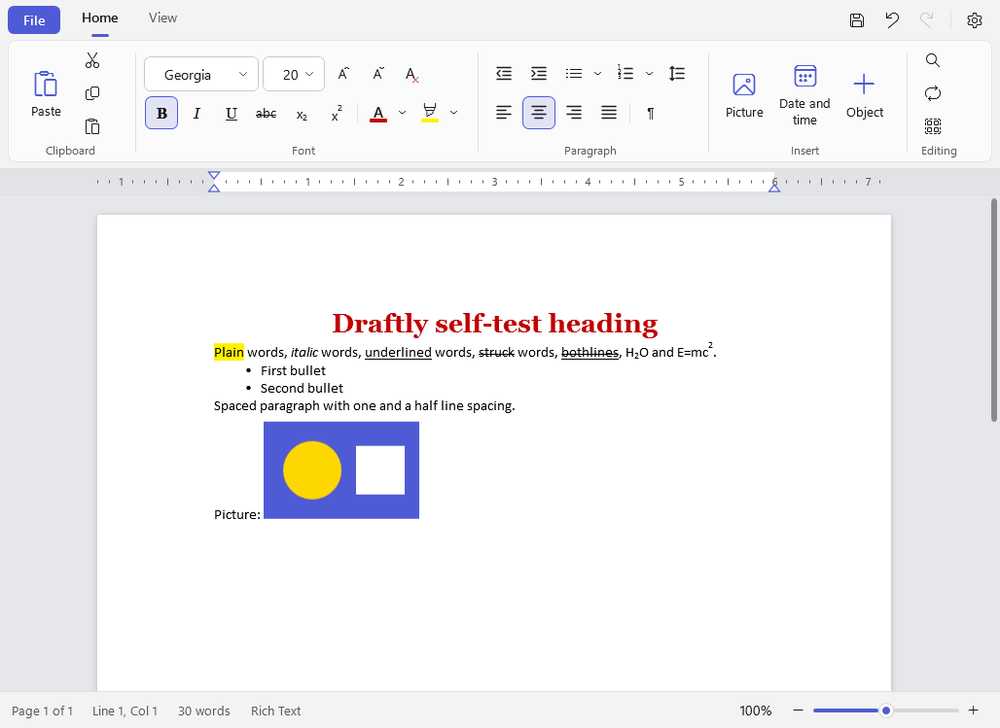
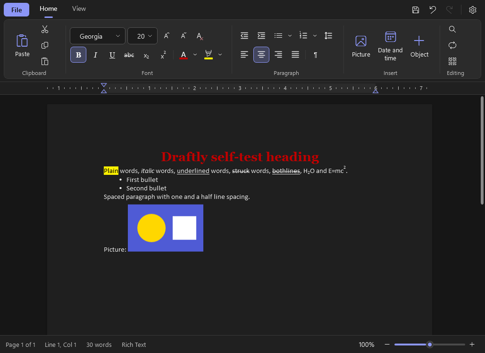
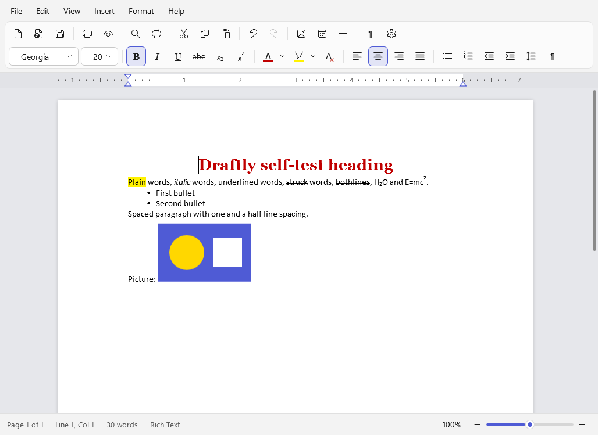
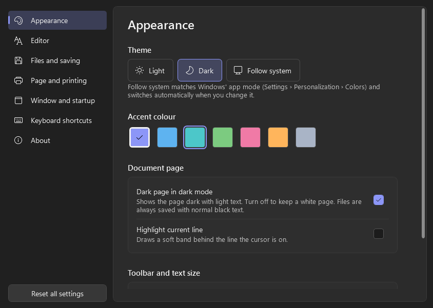

# Draftly

A modern rich text word processor for Windows 10 and 11, by **Bytehawk Studio**. It's laid out like WordPad: toolbar on top, page in the middle, status bar at the bottom. It adds a Windows 11 look, full Light/Dark/Follow System themes (including a dark page), and settings WordPad never had.

Choose your interface in **Settings › Appearance › Interface** (or the View tab / View menu):
- **Ribbon:** Home and View tabs, like WordPad in Windows 10 and 11.
- **Classic:** a menu bar (File, Edit, View, Insert, Format, Help) with a standard toolbar and a formatting toolbar, like older WordPad and Word.

| Light | Dark |
|---|---|
|  |  |

## Features

- **Clipboard:** Cut, Copy, Paste, Paste special (formatted, plain text or picture)
- **Font:** font and size, Bold, Italic, Underline, Strikethrough, Subscript, Superscript, text colour (with custom colours), highlight, Grow/Shrink, Clear formatting
- **Paragraph:** bullets and numbering (several styles), alignment, line spacing, indents, a Paragraph settings dialog, and indent markers you can drag on the ruler
- **Insert:** pictures, date and time, tables, symbols, horizontal lines, page breaks, text from another file
- **Editing:** Find, Replace (match case, whole word, direction, wrap around), Select all
- **Files:** New, Open, Save, Save As, Print, Print Preview, Page Setup, recent documents
- **View:** zoom slider (10–500%), ruler, status bar (page, line, word count), word wrap (none, window or ruler), formatting marks
- **Formats:** RTF (native) and plain text (UTF-8, UTF-8 with BOM, ANSI, UTF-16). Word `.docx` files open through Microsoft's Open XML SDK; save them as RTF or TXT. Draftly never overwrites a `.docx`.
- **Safety:** asks to save before closing or opening another document, auto-recovery after a crash or power cut, saves are crash-safe (write then swap), optional `.bak` backup copies
- **Settings:** theme, seven accent colours, dark or white page in Dark mode, default font, units, default zoom, spell check, page defaults, auto-recovery interval, text encoding, recent-file count, window memory, reopen last document, a full shortcut list, and more. Every change applies immediately.

**Classic interface**

## Tested on every build

Each push builds Draftly on Windows and runs its self-test (28 checks, including the Classic interface). The self-test formats a document, inserts a picture, saves it as RTF, reopens it and checks everything survived. It also covers WordPad-style RTF, Light/Dark/Follow System readability and persistence, Find/Replace, Undo/Redo, shortcuts, the clipboard, the save prompt, plain text and Word import, Print Preview and every dialog. Then it installs, launches and uninstalls the setup program. See [BUILD.md](BUILD.md#testing).

## Download

Get **Draftly-x.y.z-Setup.exe** (installer) or the portable **.zip** from [Releases](https://github.com/adamglassner/draftly/releases), or install it from the Bytehawk Studio Launcher.

## Keyboard shortcuts

Ctrl+N, Ctrl+O, Ctrl+S, Ctrl+Shift+S/F12 (Save as), Ctrl+P, Ctrl+F2 (Print preview), Ctrl+Z, Ctrl+Y, Ctrl+X, Ctrl+C, Ctrl+V, Ctrl+Alt+V (Paste special), Ctrl+A, Ctrl+B, Ctrl+I, Ctrl+U, Ctrl+F, Ctrl+H, F3/Shift+F3, Ctrl+L/E/R/J (align), Ctrl+1/2/5 (line spacing), Ctrl+Shift+L (bullets), Ctrl+Enter (page break), Ctrl+wheel (zoom), Ctrl+, (Settings).

## Building

See [BUILD.md](BUILD.md).

© 2026 Bytehawk Studio
